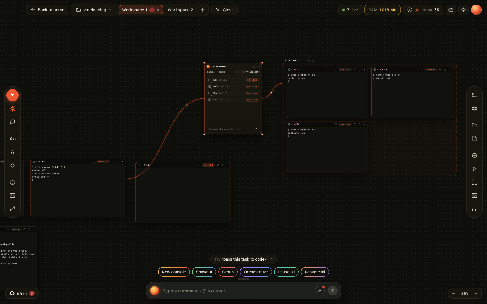
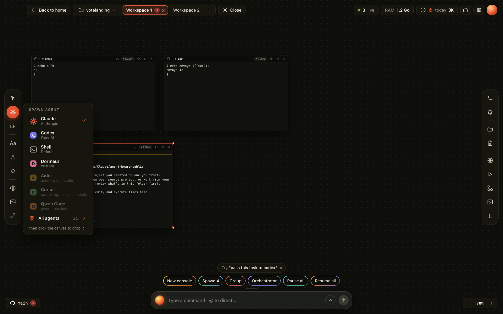
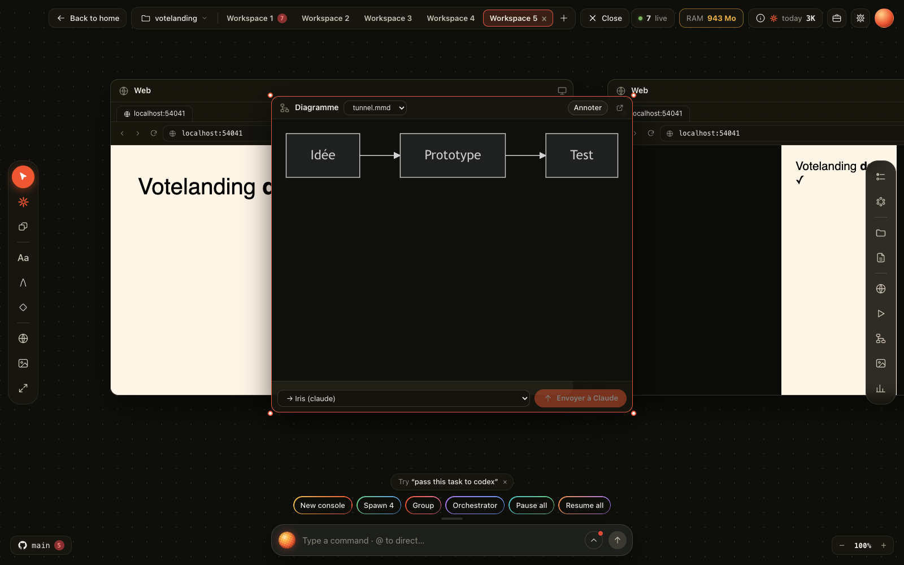

# Agent Board

Un tableau infini de **vrais terminaux d'agents IA** (Claude Code, Codex, Gemini, shells…) qui tourne 24 h/24 sur un petit VPS. Tu le pilotes depuis Chrome sur ton ordinateur.

- Chaque console a son **statut en direct** : working, needs you ou ready, avec un bip et une notification en fin de tâche.
- **Rôles par agent** : un fichier Markdown par nom de console.
- **Mémoire partagée** : un coffre Obsidian que les agents lisent et complètent.
- **Tuiles pilotées par les agents** : to-do (checklist, kanban, calendrier), diagrammes Mermaid, grilles d'images et de vidéos.
- Aussi : Git, Markdown, dessin, groupes, orchestrateur, jauge d'usage Claude.
- **Sécurité** : rien n'est exposé sur internet. Le serveur écoute `127.0.0.1` seulement, tu y accèdes par un tunnel SSH, et un jeton aléatoire est exigé partout.

```
 Ton ordinateur                                   VPS (Ubuntu)
┌──────────────────────┐   tunnel SSH chiffré   ┌───────────────────────────────┐
│ Chrome (app)         │ ─────────────────────▶ │ Board  127.0.0.1:4777         │
│  127.0.0.1:4790      │                        │  ├─ console claude « Nova »   │
│ Extension Claude     │ ◀── pont --chrome ──── │  ├─ console claude « Leo »    │
│  in Chrome           │                        │  └─ shell, codex…             │
│ Coffre Obsidian ─────┼── sync-memoire.sh ───▶ │ ~/memoire (mémoire partagée)  │
└──────────────────────┘                        │ ~/.config/*.env (clés, 600)   │
                                                └───────────────────────────────┘
```

## Captures

| Tableau : consoles, groupe et orchestrateur | Lanceur d'agents |
|---|---|
|  |  |
| **Diagramme Mermaid** écrit par un agent | |
|  | |

## Agents et modèles compatibles

Le Board n'est pas lié à Claude. Chaque console est un vrai terminal qui lance **l'agent en ligne de commande (CLI) de ton choix**, avec ton propre compte ou ta clé API. Une CLI installée sur la machine est détectée seule et apparaît dans le lanceur ; celles qui ne sont pas installées restent grisées.

| Agent (CLI) | Éditeur | Commande |
|---|---|---|
| Claude Code | Anthropic | `claude` |
| Codex | OpenAI | `codex` |
| Gemini CLI | Google | `gemini` |
| Qwen Code | Alibaba (Chine) | `qwen` |
| Kimi | Moonshot AI (Chine) | `kimi` |
| Grok | xAI | `grok` |
| Copilot | GitHub | `copilot` |
| Cursor Agent | Cursor | `cursor-agent` |
| Aider, OpenCode, Crush, Goose, Amp, Cline, Droid, Codebuff, Continue, Kilo Code, Auggie | divers | voir le lanceur |

**Utiliser un autre modèle** (DeepSeek, GLM de Zhipu, Mistral, Llama, ou n'importe quel modèle via OpenRouter ou Ollama) : passe par un agent « multi-modèles » comme **Aider**, **OpenCode**, **Crush** ou **Goose**. Tu lui donnes la clé API du fournisseur (dans `~/.config/<service>.env`) et le nom du modèle.

**Agent maison** : dans le lanceur d'agents (barre gauche) > **All agents**, tout en bas, donne un nom et une commande, par exemple `aider --model deepseek/deepseek-chat`. Cette commande devient un type de console.

Le statut en direct (working / needs you / ready) est le plus précis pour Claude Code et Codex, branchés par hooks. Pour les autres, il se déduit de l'activité du terminal.

## Installation

Deux options :

| | Sur ton PC | Sur un VPS (recommandé) |
|---|---|---|
| Pour | essayer, 0 € | agents 24 h/24, ordinateur éteint |
| Durée | ≈ 5 min | ≈ 20 min |
| Guide | **[docs/installation-pc.md](docs/installation-pc.md)** | **[docs/installation.md](docs/installation.md)** |

Résumé VPS :

1. Créer un VPS Hetzner CX23 (2 vCPU, 4 Go, ≈ 7 €/mois, Ubuntu) et s'y connecter par clé SSH.
2. Sur le VPS : `git clone` de ce dépôt puis `sudo bash deploy/install.sh`.
3. Connecter Claude Code une fois (`claude` puis `/login`).
4. Sur ton ordinateur : `client/open-board.sh` ouvre le tunnel et Chrome.
5. Optionnel :
   - clés API dans `~/.config/*.env` ;
   - coffre Obsidian synchronisé ;
   - extension Claude in Chrome pour que les agents pilotent ton navigateur.

## Utilisation

Ce que fait chaque partie de l'interface, les rôles, les tuiles et les scripts : **[docs/fonctionnement.md](docs/fonctionnement.md)**

## Ce que ce dépôt ne contient pas

Aucune donnée : pas de clé, pas de mémoire, pas de tableau, pas de conversation. Tout ce que tu crées va dans `data/`, `~/.config/` et `~/memoire/` sur **ton** VPS, et ces dossiers sont exclus de git (`.gitignore`).

## Tests

`node test.js` lance un serveur jetable sur le port 4778 et exécute les tests de l'API et de l'interface. Il faut Chrome ou Chromium en mode headless. `--no-shots` saute les captures.

## D'où vient le Board

Le Board est une réimplémentation libre, en Node.js et pour le navigateur, inspirée de **[Symvibe](https://www.symvibe.com)** : une app macOS native, payante, qui met des agents IA sur un tableau infini. Symvibe a en plus la commande vocale, le multi-comptes et une app native soignée. Va voir l'original si tu veux la version officielle, sur Mac.

Le Board n'est ni affilié à Symvibe ni soutenu par Symvibe. Le code de ce dépôt est entièrement original. La différence principale : il tourne sur un **serveur Linux** (VPS) et s'ouvre dans Chrome, donc les agents continuent quand ton ordinateur est éteint.

## Licence

MIT. Mermaid est fourni dans `public/vendor/` sous sa propre licence MIT.
